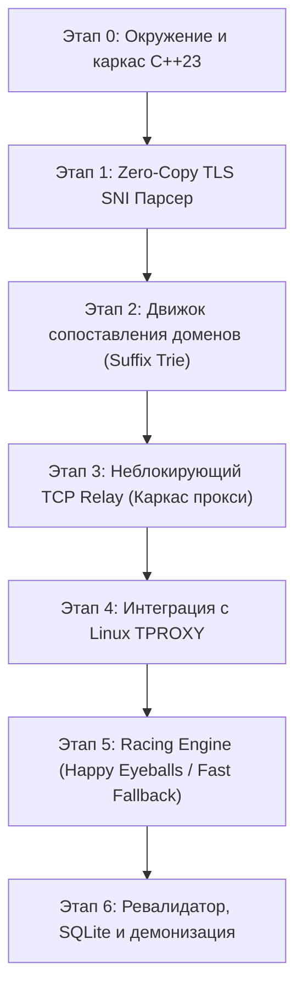

# Project Janus: Архитектура и дорожная карта разработки

> **Janus** (*Янус*) — двуликий бог дверей, входов, выходов и переходов. Одно лицо обращено к прямому сетевому маршруту (Direct Path), второе — к защищённому туннелю (Tunnel Fallback). Прозрачный адаптивный маршрутизатор трафика на C++23.

## 1. Концепция и архитектурный манифест

### 1.1. Суть проекта
Автономный прозрачный анализатор-маршрутизатор сетевого трафика, развёрнутый на базе отдельного микросервера (Raspberry Pi 4/5 или x86 mini-PC в топологии *Router-on-a-stick*). 

Система выступает шлюзом по умолчанию (Default Gateway) для домашней сети, перехватывает TCP/TLS-трафик без необходимости установки сторонних SSL/TLS-сертификатов на клиентские устройства и производит селективное проксирование заблокированных ресурсов «на лету» без возврата ошибок клиенту.

```
[ Клиент (ПК / Смартфон) ]
           │ (L3/L4 TCP к 93.184.216.34:443)
           ▼
[ Ядро Linux: nftables + TPROXY ]
           │ (Перехват через IP_TRANSPARENT, оригинальный адрес: SO_ORIGINAL_DST)
           ▼
[ Proxy Core (C++23 Event Loop: epoll / io_uring) ]
   ├── 1. Извлечение SNI из TLS ClientHello (Zero-Copy)
   ├── 2. Запрос в In-memory Suffix Trie (L1 Cache)
   │        ├── [PROXIED] ──> Мгновенный проброс в туннель (VLESS/Shadowsocks)
   │        ├── [DIRECT]  ──> Прямое подключение к целевому IP
   │        └── [UNKNOWN] ──> Запуск Racing Engine (таймаут 400 мс)
   │                              ├── SYN-ACK успешен ──> Direct + запись в белый кэш
   │                              └── RST / Drop / Timeout ──> Fallback в прокси + запись в БД блокировок
   └── 3. Передача потока (Zero-Copy splice(2))
```

### 1.2. Технологический стек
* **Целевая ОС:** Ubuntu Server 24.04 LTS (64-bit `aarch64` / `x86_64`), Linux Kernel 6.8+.
* **Язык и стандарт:** **C++23** (`-std=c++23`).
* **Компилятор:** GCC 13.2 / 14 или Clang 17+.
* **Сетевая подсистема ядра:** `nftables` (правила TPROXY), `IP_TRANSPARENT`, `SO_ORIGINAL_DST`.
* **Сетевой I/O (Data Plane):** Неблокирующий `epoll` (или `io_uring` через `liburing`), системный вызов `splice(2)`.
* **Архитектура процессов:** Thread-per-Core (Shared-Nothing для горячего пути, `SO_REUSEPORT`).
* **Базы данных и кэш:**
  * **L1 (RAM):** Suffix Radix Tree (префиксное дерево) для wildcard-доменов.
  * **L2 (Диск):** SQLite3 для хранения истории блокировок, статистики и метрик.
* **Control Plane:** Фоновый демон ревалидации (периодический прямой опрос заблокированных хостов).

---

## 2. Пошаговая дорожная карта разработки (Roadmap)

Проект разбит на логические этапы по принципу **«от чистого кода в песочнице — к интеграции с ядром Linux»**. Это позволяет разрабатывать и тестировать 80% кода прямо на рабочей машине без риска поломать домашнюю сеть.



---

### Этап 0: Подготовка окружения и каркас C++23 проекта
*Цель: создать шаблон проекта с современным CMake, санитайзерами и юнит-тестами.*
* **Что изучить:**
  * CMake 3.25+ (`target_compile_features`, `FetchContent`).
  * Санитайзеры Clang/GCC: AddressSanitizer (`ASan`), UndefinedBehaviorSanitizer (`UBSan`).
* **Практические задачи:**
  1. Создать структуру репозитория: `src/`, `include/`, `tests/`.
  2. Настроить `CMakeLists.txt` с флагами `-std=c++23 -Wall -Wextra -Wpedantic`.
  3. Подключить тестовый фреймворк (Catch2 или GoogleTest) через `FetchContent`.
  4. Реализовать базовые Value Objects и RAII-обёртку над файловым дескриптором (`UniqueFd`).

---

### Этап 1: Zero-Copy TLS SNI Парсер (L7 Inspector)
*Цель: парсер первого пакета ClientHello без аллокаций памяти и внешних библиотек.*
* **Что изучить:**
  * Спецификация TLS: RFC 5246 (TLS 1.2), RFC 8446 (TLS 1.3).
  * Структура ClientHello: Record Header $\to$ Handshake Header $\to$ Client Version / Random $\to$ Session ID $\to$ Cipher Suites $\to$ Extensions $\to$ Extension Server Name (SNI, type 0x0000).
  * `std::span<const uint8_t>`, `std::string_view`, `std::expected` в C++23.
* **Практические задачи:**
  1. Написать класс `TlsSniffer`:
     ```cpp
     std::expected<std::string_view, SnifferError> extract_sni(std::span<const uint8_t> packet);
     ```
  2. Покрыть unit-тестами на реальных дампах пакетов (дампы TLS ClientHello от curl, Chrome, Firefox можно экспортировать из Wireshark).

---

### Этап 2: Движок сопоставления доменов (Domain Matcher)
*Цель: микросекундный поиск домена с поддержкой субдоменов (*.domain.com).*
* **Что изучить:**
  * Структура данных Radix Tree / Trie (префиксное дерево).
  * Реверсивное сопоставление (поиск с TLD: `com` $\to$ `example` $\to$ `sub`).
  * Контейнеры C++23: `std::flat_set` как альтернатива для плоских списков.
* **Практические задачи:**
  1. Реализовать префиксное дерево `SuffixTrie` в памяти.
  2. Реализовать нормализацию доменов (приведение к lowercase, отсечение финальной точки).
  3. Написать бенчмарк (например, через Google Benchmark): поиск по базе в 50 000 доменов должен занимать < 1 микросекунды.

---

### Этап 3: Неблокирующий TCP Relay (Event Loop)
*Цель: базовый асинхронный прокси-сервер, умеющий соединять два сокета.*
* **Что изучить:**
  * `epoll(7)`: системные вызовы `epoll_create1`, `epoll_ctl`, `epoll_wait`.
  * Неблокирующие сокеты: флаг `O_NONBLOCK`, семантика `EAGAIN` и `EWOULDBLOCK`.
  * `splice(2)`: передача данных между двумя сокетами через pipe без выхода в user-space.
* **Практические задачи:**
  1. Написать минимальный event loop с пулом соединений (Connection Pool).
  2. Реализовать пайплайн: принять соединение $\to$ прочитать ClientHello $\to$ подключиться к заданному апстриму $\to$ замкнуть сокеты через `splice(2)`.

---

### Этап 4: Интеграция с Linux Kernel (TPROXY & Network Interception)
*Цель: сделать прокси прозрачным для операционной системы.*
* **Что изучить:**
  * Настройка маршрутизации Linux: `ip rule`, `ip route` (таблицы маршрутизации loopback/tproxy).
  * Правила `nftables` для перехвата портов 80 и 443 с действием `tproxy`.
  * Опции сокетов: `setsockopt(fd, SOL_IP, IP_TRANSPARENT, ...)`.
  * Извлечение оригинального адреса назначения: `getsockopt(fd, SOL_IP, SO_ORIGINAL_DST, ...)`.
* **Практические задачи:**
  1. Развернуть тестовую виртуальную машину (или настроить стендовый Raspberry Pi).
  2. Написать bash/systemd скрипт инициализации правил `nftables` и маршрутов `ip rule`.
  3. Модифицировать код из Этапа 3 так, чтобы сервер слушал порт `TPROXY` и корректно определял исходный IP-адрес назначения.

---

### Этап 5: Racing Engine (Happy Eyeballs & Fallback)
*Цель: логика гонки таймингов без разрыва пользовательской сессии.*
* **Что изучить:**
  * Асинхронный `connect(2)`: как отслеживать завершение через `EPOLLOUT` и проверять ошибки через `getsockopt(fd, SOL_SOCKET, SO_ERROR)`.
  * Работа с таймерами в Linux: системный вызов `timerfd_create(2)`.
  * Сохранение первого пакета: буферизация `ClientHello` в контексте соединения.
* **Практические задачи:**
  1. Реализовать стейт-машину сессии с таймером на 400 мс.
  2. Если прямой `connect` завершился успехом до таймера $\to$ отправляем буферизированный пакет напрямую.
  3. Если таймер сработал или пришёл `RST` $\to$ переключаемся на локальный сокет туннеля (SOCKS5/VLESS), пересылаем буферизированный пакет туда.
  4. Асинхронно передать заблокированный домен в модуль кэширования.

---

### Этап 6: Ревалидатор, хранилище SQLite и демонизация
*Цель: завершение проекта, фоновые задачи и отказоустойчивость.*
* **Что изучить:**
  * SQLite C API (или библиотека-обёртка `sqlite_orm` / чистый C API с RAII).
  * Systemd unit files: автозапуск, мониторинг падений (`Restart=always`), Capabilities (`CAP_NET_ADMIN`, `CAP_NET_BIND_SERVICE` без запуска от root).
* **Практические задачи:**
  1. Спроектировать схему SQLite: таблица заблокированных доменов (`domain`, `first_blocked_at`, `last_checked_at`, `status`).
  2. Реализовать фоновый таймер (раз в неделю): обход базы, отправка прямого TCP/TLS запроса к хостам. Если ресурс доступен $\to$ удаление из черного списка.
  3. Оформить проект в виде systemd-демона.

---

## 3. Рекомендуемые материалы для изучения

1. **Сетевой стек Linux:**
   * *Книга:* «The Linux Programming Interface» (Michael Kerrisk) — главы по сокетам, `epoll`, неблокирующему I/O.
   * *Статьи Cloudflare:* [How we built Spectrum](https://blog.cloudflare.com/how-we-built-spectrum/) (детальный разбор TPROXY, IP_TRANSPARENT и SO_REUSEPORT).
2. **Протоколы:**
   * RFC 8446: The Transport Layer Security (TLS) Protocol Version 1.3.
3. **Современный C++:**
   * Документация [cppreference.com](https://en.cppreference.com/): разделы по `std::expected`, `std::span`, `std::flat_set`, `<print>`.
   * Паттерны Zero-Cost Abstractions и Data-Oriented Design в C++.
